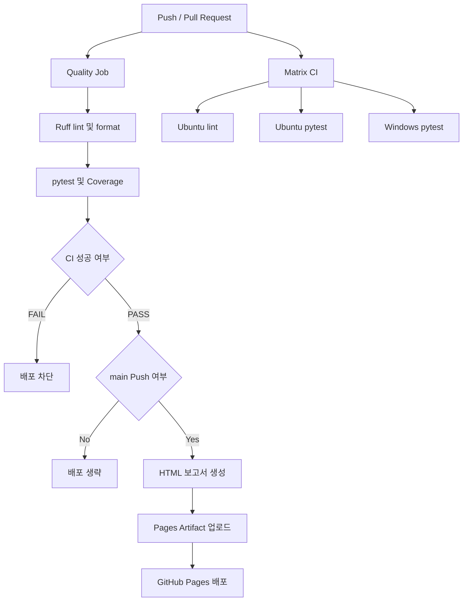

# OrderLab — Python CI/CD

## 1. 프로젝트 소개

Python 기반 주문 및 매출 관리 프로그램을 개발하고, Ruff, pytest, GitHub Actions를 활용하여 코드 품질 검사, 자동 테스트 및 자동 배포를 구현하는 프로젝트이다.

## 2. 개발 환경

| 구분 | 사용 기술 |
|---|---|
| Language | Python |
| Framework | FastAPI |
| Linter | Ruff |
| Formatter | Ruff |
| Testing | pytest |
| Coverage | pytest-cov |
| API Testing | TestClient |
| CI/CD | GitHub Actions |
| Deployment | GitHub Pages |
| OS | Windows, Ubuntu |

## 3. 프로젝트 구조

```text
ci-cd-study/
├── .github/
│   └── workflows/
│       ├── ci.yml
│       └── matrix-ci.yml
├── orderlab/
│   ├── __init__.py
│   ├── pricing.py
│   ├── csv_report.py
│   └── api.py
├── tests/
│   ├── conftest.py
│   ├── test_pricing.py
│   ├── test_csv_report.py
│   └── test_api.py
├── data/
│   └── sample_orders.csv
├── generate_report.py
├── requirements-dev.txt
├── .gitignore
└── README.md
```

## 4. Level별 구현 내용

| Level | 주요 학습 내용 | 구현 결과 |
|---|---|---|
| 1 | pytest, Ruff | 주문 금액 계산 및 자동 검사 |
| 2 | raises, parametrize | 할인, 배송비, 예외 및 경계값 검증 |
| 3 | tmp_path, fixture, Coverage | CSV 매출 집계 및 Coverage Artifact 생성 |
| 4 | FastAPI, TestClient, Matrix | API 테스트 및 OS별 병렬 검사 |
| 5 | GitHub Actions, GitHub Pages | CI 통과 후 정적 HTML 자동 배포 |

## 5. 실행 방법

### 5.1 저장소 복제

```bash
git clone https://github.com/dkfkaf/ci-cd-study.git
cd ci-cd-study
```

### 5.2 가상환경 생성 및 활성화

Windows PowerShell 기준:

```powershell
python -m venv .venv
.\.venv\Scripts\Activate.ps1
```

### 5.3 의존성 설치

```bash
python -m pip install -r requirements-dev.txt
```

### 5.4 코드 품질 검사

```bash
ruff check .
ruff format --check .
```

### 5.5 자동 테스트

```bash
python -m pytest -v
```

검증 결과: 21개 테스트 통과

### 5.6 테스트 커버리지 측정

```bash
python -m pytest --cov=orderlab --cov-report=term-missing
python -m pytest --cov=orderlab --cov-report=xml
```

생성된 coverage.xml은 GitHub Actions Artifact로 업로드된다.

### 5.7 HTML 보고서 생성

```bash
python generate_report.py
```

생성 파일:

```text
site/index.html
```

샘플 CSV 기준 총매출: 35,000 KRW

## 6. CI/CD 파이프라인



### CI/CD 실행 조건

| 이벤트 | CI | CD |
|---|---|---|
| Pull Request | 실행 | 생략 |
| main Push + CI PASS | 실행 | 실행 |
| main Push + CI FAIL | 실행 | 차단 |

## 7. 실패 재현 및 해결 과정

### 7.1 Ruff import 오류

- 원인: import 정렬 규칙 위반 및 pytest, TestClient import 누락
- 오류 코드: I001, F821
- 해결: 누락된 import 추가 및 Ruff 자동 수정

```bash
ruff check . --fix
ruff format .
```

### 7.2 API 테스트 실패

- 원인: 실제 API 응답과 테스트 기대값의 대소문자 불일치
- 실제 응답: Not found
- 기대 응답: not found
- 해결: 테스트 기대값을 Not found로 수정

### 7.3 할인 계산 오류

실수형 할인 계산을 정수형 할인 계산으로 수정하였다.

수정 전:

```python
amount -= amount * discount / 100
```

수정 후:

```python
amount -= amount * discount // 100
```

### 7.4 의도적인 pytest 실패 재현

배포 차단 여부를 검증하기 위해 테스트의 기대값을 의도적으로 변경하였다.

실패 코드:

```python
def test_subtotal_zero_quantity():
    assert subtotal(10_000, 0) == 999
```

실행 결과:

- Ruff 검사: PASS
- pytest: FAIL
- Coverage Artifact: 업로드 성공
- Deploy Job: SKIPPED

정상 복구 코드:

```python
def test_subtotal_zero_quantity():
    assert subtotal(10_000, 0) == 0
```

수정 후 전체 테스트 21개가 통과하였으며, CI/CD 재실행을 통해 정상 배포를 확인하였다.

## 8. GitHub 협업 실습

다음 과정을 통해 GitHub 기반 협업 및 자동 검증을 실습하였다.

1. feature/ci-test 브랜치 생성
2. 새로운 테스트 작성
3. Pull Request 생성
4. CI 자동 실행 확인
5. 의도적인 테스트 실패 재현
6. 오류 수정 및 CI 재검증
7. main 브랜치 병합
8. GitHub Pages 자동 배포 확인

## 9. 최종 검증 결과

- [x] 정상, 예외, 경계값 테스트
- [x] pytest Fixture 적용
- [x] Ruff lint 검사
- [x] Ruff format 검사
- [x] 전체 테스트 21개 통과
- [x] Coverage Artifact 업로드
- [x] Ubuntu Matrix CI
- [x] Windows Matrix CI
- [x] Pull Request 자동 검사
- [x] CI 실패 시 배포 차단
- [x] GitHub Pages 자동 배포
- [x] .gitignore 적용 및 저장소 정리

## 10. 결과 확인

- Repository: https://github.com/dkfkaf/ci-cd-study
- GitHub Actions: https://github.com/dkfkaf/ci-cd-study/actions
- Pull Request: https://github.com/dkfkaf/ci-cd-study/pull/1
- 실패 재현 기록: https://github.com/dkfkaf/ci-cd-study/actions/runs/46140396199
- 최종 CI/CD 성공 기록: https://github.com/dkfkaf/ci-cd-study/actions/runs/46140627704
- Matrix CI 성공 기록: https://github.com/dkfkaf/ci-cd-study/actions/runs/46140627699
- GitHub Pages: https://dkfkaf.github.io/ci-cd-study/

## 11. 결론

Python 프로그램의 기능 구현뿐만 아니라 코드 품질 검사, 자동 테스트, 커버리지 측정, 운영체제별 테스트, Pull Request 기반 협업 및 자동 배포까지 전체 CI/CD 과정을 구현하였다.

이를 통해 테스트가 실패한 코드의 배포를 차단하고, 검증된 코드만 배포하는 자동화 파이프라인을 구축하였다.
